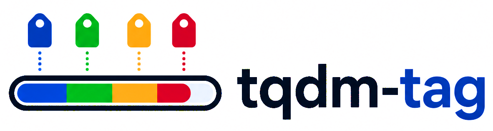
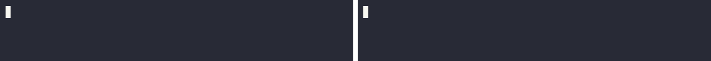
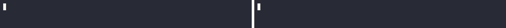

<p align="center">
  
</p>

# tqdm-tag

> Color-code individual items in a tqdm progress bar by tagging them with a status.

[](https://pypi.org/project/tqdm-tag/)
[](https://pypi.org/project/tqdm-tag/)
[](https://github.com/ColinMoldenhauer/tqdm-tag/actions/workflows/tests.yml)
[](https://tqdm-tag.readthedocs.io)
[](LICENSE)

**tqdm-tag** extends [tqdm](https://tqdm.github.io/) so you can attach custom tags to any item inside your loop. The corresponding segment of the progress bar fills with that tag's color, giving you an at-a-glance overview of status per item — without waiting for the loop to finish.


<table>
  <tr>
    <th width="50%">tqdm-tag: each item colored by tag</th>
    <th width="50%">plain tqdm: monochrome</th>
  </tr>
  <tr>
    <td colspan="2"></td>
  </tr>
</table>


## Installation

```bash
pip install tqdm-tag
```

## Usage

`TqdmErrorTag` is a drop-in replacement for `tqdm` — swap the class name and you're done. Call `.warn()` or `.error()` on any item to color that segment of the bar:

```python
from tqdm_tag import TqdmErrorTag

pbar = TqdmErrorTag(range(100), legend=True, desc="Processing")
for item in pbar:
    result = process(item)
    if result.has_warning: pbar.warn()
    if result.has_error:   pbar.error()
```

With `legend=True`, a live second line below the bar shows running counts:

<table>
  <tr>
    <th width="50%"><code>legend=True</code></th>
    <th width="50%"><code>legend=False</code> (default)</th>
  </tr>
  <tr>
    <td colspan="2"></td>
  </tr>
</table>

### Custom tags with TqdmTag

For full control, use `TqdmTag` with `Tag` objects. Each `Tag` groups name, color, and an optional status integer (auto-assigned if omitted):

```python
from tqdm_tag import Tag, TqdmTag

pbar = TqdmTag(
    range(100),
    tags=[Tag("warn", color="yellow"), Tag("error", color="red")],
    legend=True,
)
for i in pbar:
    if i == 10: pbar.tag("warn")    # reference by name string
    if i == 80: pbar.tag("error")
```

> [!NOTE]
> When `total` is known, per-item status is stored in a fixed `uint8` array (0-255) for memory efficiency, so at most 256 distinct status values are available. Registering a `Tag` (or calling `.tag()`) with a `status` outside that range raises a warning at registration time, ahead of the `OverflowError` it would otherwise cause once an item is actually tagged with it.

### Add tags on the fly

Pass a `Tag` object directly to `.tag()` to register and apply it in one call. Subsequent calls can use the name string:

```python
from tqdm_tag import Tag, TqdmTag

pbar = TqdmTag(range(100))
for i in pbar:
    if i == 10: pbar.tag(Tag("warn",  color="yellow"))  # registers + applies
    if i == 30: pbar.tag("warn")                        # reuse by name
    if i == 80: pbar.tag(Tag("error", color="red"))
```

### Manual mode (no iterable)

Skip the `for` loop and drive the bar yourself — `.tag()` calls `update(1)` internally, so no separate `.update()` call is needed:

```python
from tqdm_tag import TqdmErrorTag

pbar = TqdmErrorTag(total=100)
for future in as_completed(futures):
    if future.result().ok:
        pbar.tag("default")
    else:
        pbar.error()
```

For out-of-order completions where a specific item's slot matters (e.g. retries, or `as_completed` where you know each future's original index), pass `index=` instead of relying on completion order:

```python
if future.result().ok:
    pbar.tag("default", index=future_to_index[future])
else:
    pbar.error(index=future_to_index[future])
```

### Turn the whole bar green on success

```python
import time
from tqdm_tag import TqdmTag

items = range(50)
pbar = TqdmTag(items, colour="red")
for i in pbar:
    time.sleep(0.05)
    if i == len(items) - 1:
        pbar.tag("default", color="green")
```

### Customize the legend

Tags in the legend are ordered by status value. Pass a `legend_format` callable to take full control — it receives `tag_counts` (dict of name → count) and `tag_to_color` (dict of name → color):

```python
def my_legend(counts, colors):
    return "  ".join(f"[{k.upper()}={v}]" for k, v in counts.items())

pbar = TqdmErrorTag(range(100), legend=True, legend_format=my_legend)
```

Every item starts out under the implicit `"default"` tag. Rename it with `default_tag_name` (e.g. if `"default"` collides with one of your own tag names), and show its running count in the legend with `legend_show_default`:

```python
pbar = TqdmTag(
    range(100),
    tags=[Tag("warn", color="yellow")],
    default_tag_name="pending",
    legend=True,
    legend_show_default=True,  # legend now includes "pending: N"
)
for i in pbar:
    if i == 10: pbar.tag("warn")
    if i == 90: pbar.tag("pending", color="green")  # re-color the default tag
```

Registered tags show up in the legend with a count of `0` until first used. Pass `prune_legend=True` to hide them until then:

```python
pbar = TqdmTag(
    range(100),
    tags=[Tag("warn", color="yellow"), Tag("error", color="red")],
    legend=True,
    prune_legend=True,  # "warn"/"error" only appear once tagged at least once
)
```

### Reduce operation for dense bars

When the terminal is narrow, multiple items share one bar segment. Use `reduce_op` to control which status wins, and `reduce_ignore_default` to skip untagged items:

```python
from tqdm_tag import Tag, TqdmTag

pbar = TqdmTag(
    range(100),
    tags=[Tag("warn", color="yellow", status=1), Tag("error", color="red", status=2)],
    reduce_op=max,              # highest-severity status wins
    reduce_ignore_default=True, # don't let untagged items dilute the color
)
for i in pbar:
    if i % 10 == 1: pbar.tag("warn")
    if i % 10 == 2: pbar.tag("error")
```

A segment that's genuinely mixed (not every item shares one status) doesn't just flatten to `reduce_op`'s winner — it's reduced a second time over whatever's left, and rendered as a single character split proportionally between the winner's color (foreground) and the runner-up's color (background), so a minority status stays visible instead of being fully outvoted or fully hiding the majority. This only applies with the default Unicode charset; `ascii=True` bars fall back to the flat winner color, since ASCII has no sub-character glyphs to blend with.

### Resume a bar after a restart

Pass `initial` (the number of items already done) so the bar picks up at the right percentage, and `initial_status` to restore the previous run's per-item tags instead of showing that prefix as untagged:

```python
from tqdm_tag import Tag, TqdmTag

tags = [Tag("warn", color="yellow", status=1), Tag("error", color="red", status=2)]

# first run got 30/100 done, with items 5 and 12 warned, item 21 errored
pbar = TqdmTag(
    range(30, 100),
    total=100,
    initial=30,
    tags=tags,
    initial_status={5: 1, 12: 1, 21: 2},  # {index: status}, e.g. loaded from a checkpoint
)
for i in pbar:
    ...
```

`initial_status` also accepts a sparse `(2, N)` array (`[indices, statuses]`) or a dense `(total,)` array giving every item's status directly.

### Retag an item by index

Pass `index` to `.tag()` to target a specific slot instead of the current item. In manual (non-iterable) mode, whether this advances the bar depends on whether that slot was ever tagged before: the first `tag(..., index=i)` for a given `i` counts it (same as `index=None` would), while a later `tag(..., index=i)` call on that same slot is treated as a retry and leaves `n` alone:

```python
from tqdm_tag import Tag, TqdmTag

tags = [Tag("success", color="green", status=1), Tag("error", color="red", status=2)]
pbar = TqdmTag(total=len(items), tags=tags)

for i, item in enumerate(items):
    try:
        process(item)
        pbar.tag("success")
    except Exception:
        pbar.tag("error")  # n advances either way

# later: retry failed items, flip their status without touching n
# (these slots were already tagged above, so this is recognized as a retry)
for i in failed_indices:
    if retry(items[i]):
        pbar.tag("success", index=i)
```

`index` also fits out-of-order completions in manual mode (e.g. iterating `concurrent.futures.as_completed` directly, not via `for x in pbar`), where the true slot for a completed item has to be looked up rather than assumed from completion order - the first `tag(..., index=true_idx)` for a slot both records its status and counts it. Works whether or not `total` is known.

**Caveat:** the "already tagged?" check only sees slots that went through `.tag()` (or `initial_status`/iteration). If you count an item with a bare `pbar.update(1)` and never `.tag()` that slot, it's harmless on its own - but if you *later* call `tag(..., index=that_slot)` for the first time, it'll look unseen and advance `n` again, double-counting it. If you're going to `.tag(index=...)` a slot at all, route its completion through `.tag()` from the start (even the plain-success case, e.g. `pbar.tag("success", index=i)`) rather than mixing in a separate `update(1)` for the same slot.

## API

| Class | Description |
|---|---|
| `TqdmErrorTag` | Drop-in replacement with pre-wired `warn` / `error` tags and `.warn()` / `.error()` helpers |
| `TqdmTag` | Core class for fully custom tags |
| `Tag` | Dataclass grouping a tag's `name`, `color`, and `status` |
| `ColoredBar` | Internal `Bar` subclass that renders ANSI-colored segments |

Full API reference: **[tqdm-tag.readthedocs.io](https://tqdm-tag.readthedocs.io)**

## License

[MIT](LICENSE) © Colin Moldenhauer
